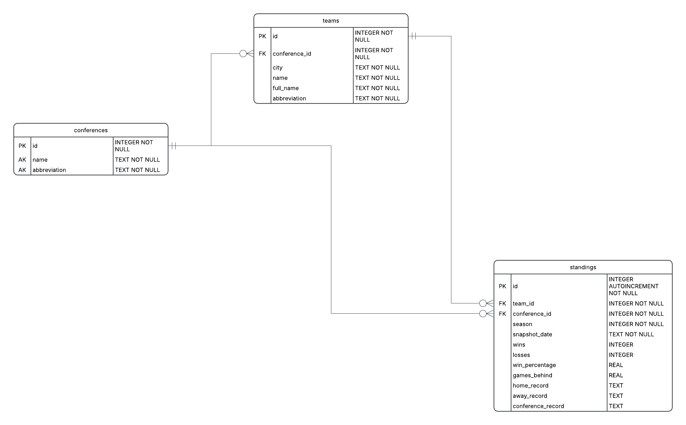

# 2026 ACC FBS Standings

Interactive Streamlit dashboard for the latest ACC standings in the checked-in snapshots. The team filter updates the wins chart, losses chart, and standings table.

Public dashboard URL: https://f26-day2-team3.streamlit.app/

Run locally: `python -m pip install -r requirements.txt`
Launch: `streamlit run src/app.py`

### Team 3 - Sprint Roles

SPRINT 1: DATA PIPELINE (Sep 10 – Sep 24) 
Scrum Master: Aaron | Tester: Robiel | Developer: Wyatt & Krish

SPRINT 2: DASHBOARD & AUTOMATION (Oct 1 – Oct 15) Scrum Master: Krish | Tester: Aaron | Developer: Robiel & Wyatt

BUFFER & LAUNCH PHASE (Oct 22) 
Scrum Master: Robiel | Tester: Wyatt | Developer: Krish & Aaron

SPRINT 3: AI LAYER & INTEGRATION (Oct 29 – Nov 12) 
Scrum Master: Wyatt | Tester: Robiel | Developer: Krish & Aaron

WRAP-UP & SHOWCASE (Nov 19 – Dec 10) 
Scrum Master: Robiel | Tester: Krish | Presenters: Aaron & Wyatt

### Schema Markdown

### `conferences`
| Key | Column | Type | Constraints |
| :--- | :--- | :--- | :--- |
| **PK** | id | INTEGER | NOT NULL |
| AK | name | TEXT | NOT NULL |
| AK | abbreviation | TEXT | NOT NULL |

### `teams`
| Key | Column | Type | Constraints |
| :--- | :--- | :--- | :--- |
| **PK** | id | INTEGER | NOT NULL |
| FK | conference_id | INTEGER | NOT NULL |
| | city | TEXT | NOT NULL |
| | name | TEXT | NOT NULL |
| | full_name | TEXT | NOT NULL |
| | abbreviation | TEXT | NOT NULL |

### `standings`
| Key | Column | Type | Constraints |
| :--- | :--- | :--- | :--- |
| **PK** | id | INTEGER | AUTOINCREMENT NOT NULL |
| FK | team_id | INTEGER | NOT NULL |
| FK | conference_id | INTEGER | NOT NULL |
| | season | INTEGER | NOT NULL |
| | snapshot_date | TEXT | NOT NULL |
| | wins | INTEGER | |
| | losses | INTEGER | |
| | win_percentage | REAL | |
| | games_behind | REAL | |
| | home_record | TEXT | |
| | away_record | TEXT | |
| | conference_record | TEXT | |

  

